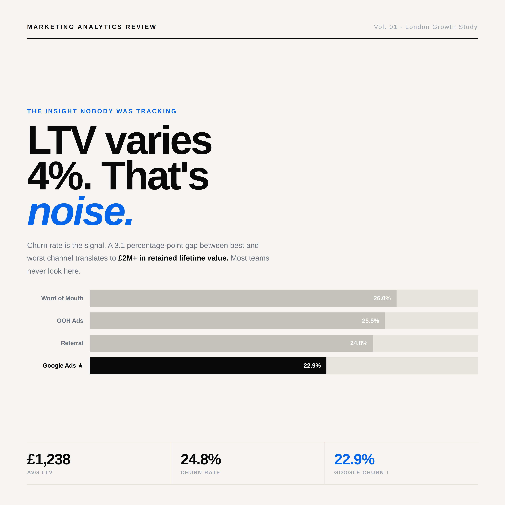
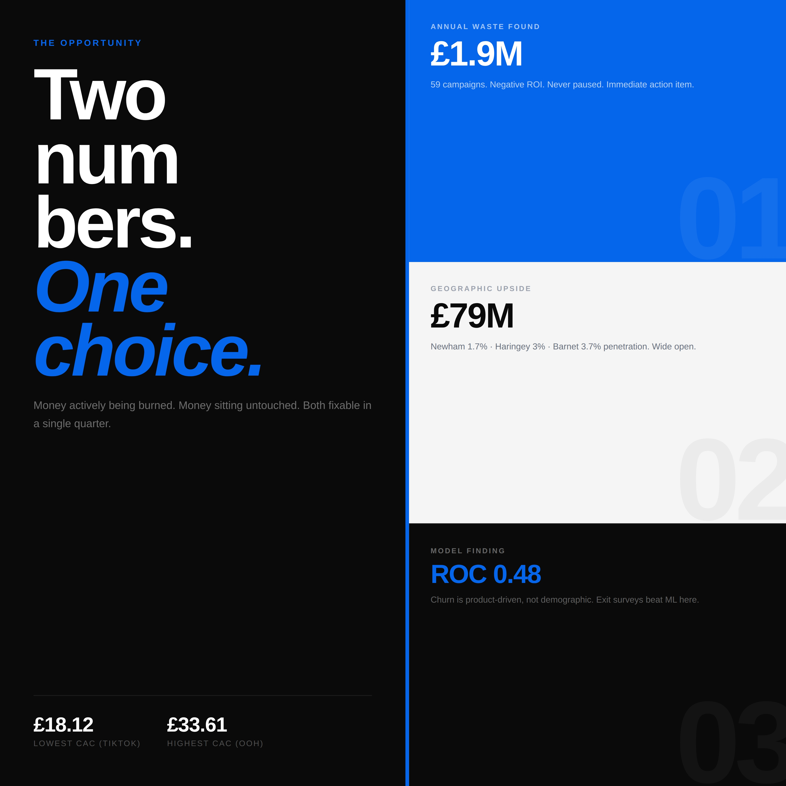
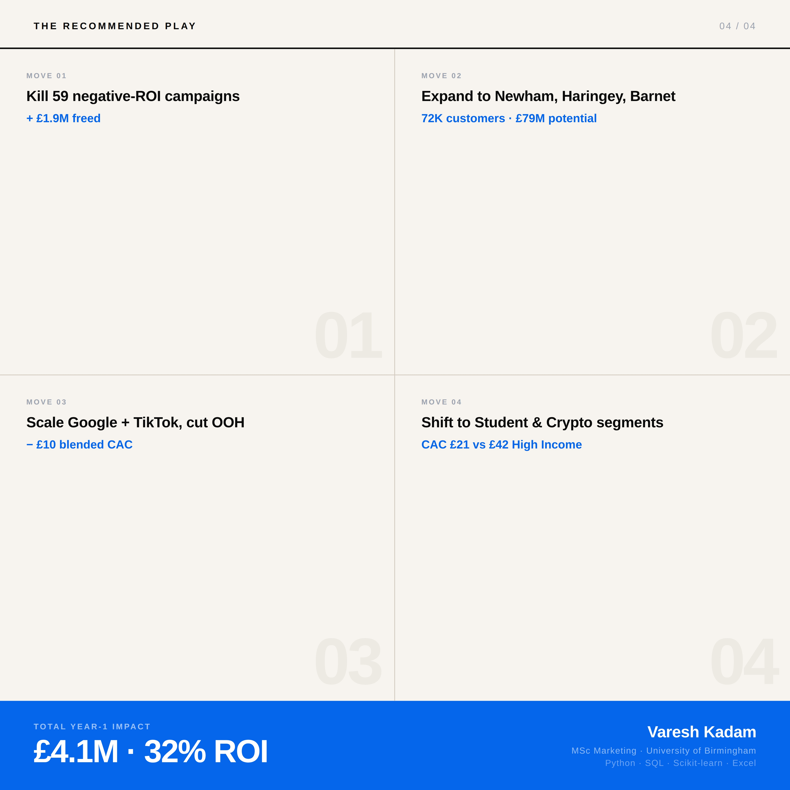

# Revolut London Growth Study

> Where does a fintech app waste acquisition spend in London, and which boroughs are the biggest untapped opportunity?


**This project uses a simulated dataset. It is not real Revolut data and has no affiliation with Revolut.** The point is the method: how to find wasted spend, score markets and report honestly when a model fails.

## The dataset (simulated)

| File | What it holds | Size |
|---|---|---|
| `data/customer_data.csv` | Customers with borough, income, spend, channel, months active, churn flag | 10,000 rows |
| `data/campaign_data.csv` | Campaigns with spend, impressions, clicks, signups, CAC and ROI | 500 rows |
| `data/borough_data.csv` | London boroughs with population, income, fintech awareness, footfall | 33 rows |
| `data/monthly_trends.csv` | Monthly signups, users, churn and marketing spend | monthly |

## What I did

1. **Checked the data first.** Shape, missing values, and funnel sanity checks (clicks above impressions, signups above clicks, paid above signups).
2. **Wrote SQL (SQLite)** for average lifetime value by acquisition channel and estimated revenue by borough (`sql_analysis.py`).
3. **Built a borough opportunity score** in Python (`data_checks_and_scoring.py`). Features are scaled with MinMaxScaler, then weighted: income 25%, young professionals 25%, fintech awareness 20%, commuter footfall 15%, minus current Revolut penetration 15%.
4. **Estimated lifetime value** as monthly spend x 2% interchange revenue (an assumption) x months active.
5. **Summarised it in four slides** (see `slides/`).

## Findings

| Question | Answer |
|---|---|
| Where is spend wasted? | **59 of 500 campaigns** have negative ROI. They account for **£1.91M** of **£12.70M** simulated spend, about 15%. I recomputed this from `campaign_data.csv`. |
| Where is the upside? | The slides estimate about **£79M** of revenue upside in low-penetration boroughs, led by Newham, Haringey and Barnet. |
| Is churn predictable from demographics? | No. The Random Forest churn model scored a ROC AUC of **0.48**, barely better than chance. |

## The honest part

The churn model failed, and the slides say so. In the simulated data, 2,480 of 10,000 customers are flagged as churned (24.8%), but demographics did not predict who. My recommendation was to run **exit surveys** and look at product reasons rather than build a fancier model. A clear null result is more useful than an impressive-looking wrong one.

## Slides

| | |
|---|---|
|  |  |
|  |  |

## Honest limits

- Everything here is simulated, so the pound figures show how the method works, not real Revolut performance.
- Borough scores depend on my chosen weights. Different weights would reorder the list.
- The 2% interchange rate is an assumption, not a measured figure.
- The code for the Random Forest churn model is not in this repository yet. Only its result is reported in the slides.
- `data_checks_and_scoring.py` was previously named `generate_data.py`. It checks and scores the data. It does not generate it.

## How to run

```bash
git clone https://github.com/iguesshecodes/revolut-london-growth-study.git
cd revolut-london-growth-study
pip install -r requirements.txt
python sql_analysis.py            # builds revolut.db and revolut_marketing_analysis.xlsx
python data_checks_and_scoring.py # data checks, borough scoring, LTV
```

## Contact

[LinkedIn](https://www.linkedin.com/in/vareshnirbhavne) | [Portfolio](https://vareshportfolio.vercel.app) | vareshworks@gmail.com
